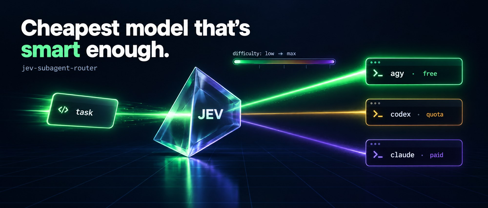
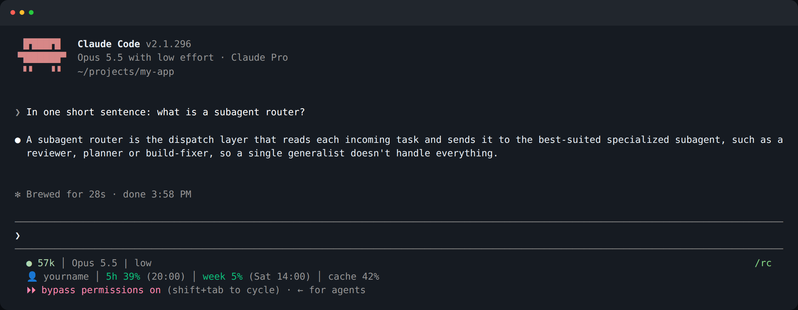
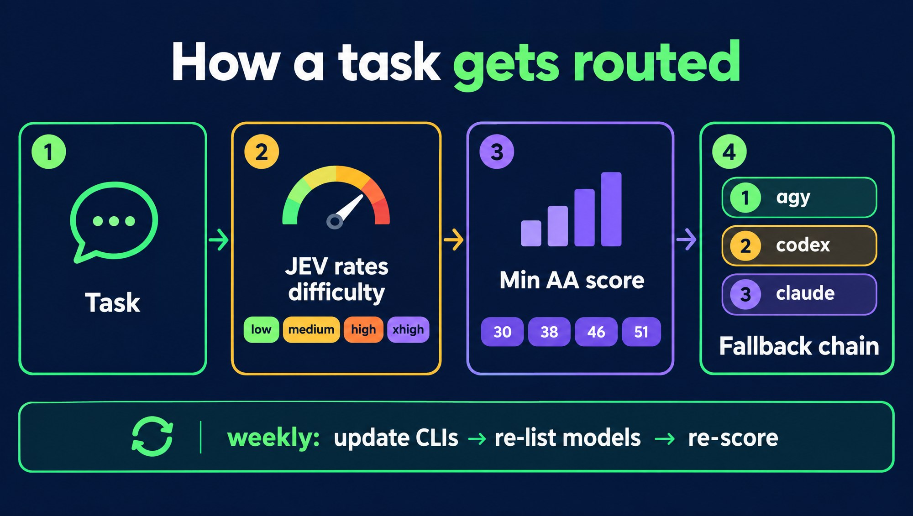
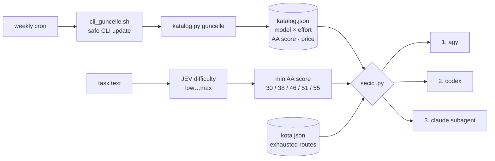

<p align="center">
  
</p>

<h1 align="center">Your AI is burning its best model on "summarize this log."</h1>

<p align="center"><b>jev-subagent-router</b> picks the cheapest model that is <i>smart enough</i> — in 0.3 seconds, for a fraction of a cent.</p>

<p align="center">
  🆓 free quotas first &nbsp;·&nbsp; 🧠 difficulty-graded by JEV &nbsp;·&nbsp; 📊 scored by Artificial Analysis &nbsp;·&nbsp; 🔄 catalog refreshes itself weekly
</p>

---

### In 10 seconds

| Without it | With it |
|---|---|
| Every task goes to your most expensive model | Each task gets the **minimum intelligence it needs** |
| Free `agy` / `codex` quotas sit unused | Free routes are tried **first**, paid last |
| New model drops, routing table goes stale | A weekly job **re-lists and re-scores every model** |
| You find out the quota is gone mid-task | Your **5-hour and weekly quota** sit in the status line |

```
$ python3 secici.py "find the root cause of the look-ahead bug in the engine"
zorluk high (min AA 46)
  1. agy    Claude Sonnet 5.5 (High)     AA  46.8  ->  agy --print "<prompt>" --model claude-sonnet-5-5-high
  2. codex  GPT 6.1 Sol (medium)         AA  47.8  ->  codex exec -m gpt-6.1-sol -c model_reasoning_effort=medium "<prompt>"
  3. claude Claude Sonnet 5.5 (high)     AA  46.8  ->  Agent(model="sonnet")  # effort high
```

Try #1. Quota gone? Mark it and fall through to #2, then #3.

<p align="center"></p>
<p align="center"><sub>Live session: quota and cache in the status line, so you never hit the wall by surprise.</sub></p>

### Built on

| | What it does here |
|---|---|
| **[JEV](https://openrouter.ai)** (OpenRouter) | Reads the task, rates difficulty `low … max` with probabilities |
| **[Artificial Analysis](https://artificialanalysis.ai)** | Intelligence score for every model × reasoning effort |
| **[OpenRouter](https://openrouter.ai)** | Per-token price, used as relative cost |
| **Antigravity `agy`** | Route 1, free quota (Gemini, Claude) |
| **OpenAI `codex`** | Route 2, subscription quota (GPT-6 family) |
| **Claude Code** | Route 3 (subagents), plus the gate hook and the status line |

---

## Why

Agent setups usually burn their most expensive model on everything, including "summarize these
three logs". Meanwhile free and subscription routes (Antigravity `agy`, OpenAI `codex`) sit idle,
and new models land every few weeks without anyone updating the routing table.

This project fixes three things:

1. **Difficulty decides the bar, not habit.** [JEV](https://openrouter.ai) (`~typesafe/jev-latest`,
   OpenRouter's public decision model) rates the task `low … max` in ~0.3 s for a tiny fraction of a
   cent. That level maps to a minimum [Artificial Analysis](https://artificialanalysis.ai) intelligence score.
   JEV is the backbone: it returns probabilities, and the router only raises a level when JEV is
   confident. Risky topics (data loss, security, real money) are floored at `high`.
2. **Free first, cheap second, smart enough always.** Routes are tried `agy → codex → claude`. Inside a
   route the winner is the cheapest model, then the lowest reasoning effort, then the smartest.
3. **The catalog maintains itself.** A weekly job updates the CLIs (without touching their config),
   re-lists every model + reasoning level they offer, and re-scores them.

## How it works

<p align="center"></p>



| Difficulty | Min AA score | Typical pick |
|---|---|---|
| low | 30 | Gemini Flash (agy) |
| medium | 38 | Gemini 3.8 Flash Medium → GPT-6 Luna → Sonnet medium |
| high | 46 | Sonnet High (agy) → GPT-6.1 Sol medium → Sonnet high |
| xhigh | 51 | Opus Medium (agy) → GPT-6.1 Sol xhigh → Sonnet xhigh |
| max | 55 | strongest open model |

## Components

| File | What it does |
|---|---|
| `zorluk.py` | The JEV call: task text → `low/medium/high/xhigh` with confidence thresholds and a risk floor. If JEV is unreachable it falls back to `medium`, so routing never stops. |
| `katalog.py` | Builds `katalog.json`: every model and reasoning level from `agy models`, `codex debug models`, and the newest Claude Sonnet/Opus. Adds AA intelligence score and OpenRouter price (used as relative cost, since the CLIs bill quota, not dollars). **Refuses to write** if under half the models match AA or a route is missing, so a broken run never replaces a good catalog. |
| `secici.py` | Task → fallback chain with ready-to-run commands. `--kota-bitti` / `--quota-out <route> [hours]` skips a route until its quota resets (default 5h). `--json` for scripts. |
| `ajan_kapisi.py` | Claude Code `PreToolUse` hook on `Agent`: a subagent is **denied** unless `secici.py` ran in the last 15 minutes. Every call is logged; `--rapor` shows how many went through the router. Fails open when its log is broken. |
| `cli_guncelle.sh` | Runs each CLI's own `update`. Backs up the config files first and **restores any config the update changed**. Logs a broken binary loudly. |
| `haftalik.sh` | Weekly pipeline: CLI update → catalog → commit and push `katalog.json`. |

## Setup

Requirements: Python 3.10+ (stdlib only), the `agy`, `codex` and `claude` CLIs, and two keys:

```bash
export OPENROUTER_API_KEY=...   # JEV difficulty calls + model prices
export AA_API_KEY=...           # Artificial Analysis scores (free tier is enough)
```

Optional environment:

| Variable | Default | Purpose |
|---|---|---|
| `JEV_LOG_DIR` | `~/.jev-router/logs` | selection, gate and weekly logs |
| `KEY_FILE` | `~/.env` | file `haftalik.sh` reads `AA_API_KEY` from |
| `JEV_EXTRA_PATH` | — | dir with your own `jev` / `jev_efor` modules (otherwise the bundled `zorluk.py` is used) |

```bash
python3 katalog.py guncelle          # build the catalog
python3 katalog.py goster            # inspect it
python3 secici.py "your task"        # get a chain
```

Weekly cron (Sunday 04:30), under `flock` so runs never overlap:

```cron
30 4 * * 0 flock -n /tmp/alt_ajan_haftalik.lock /path/to/haftalik.sh
```

Gate hook in `~/.claude/settings.json`:

```json
{"hooks": {"PreToolUse": [{"matcher": "Agent",
  "hooks": [{"type": "command", "command": "python3 /path/to/ajan_kapisi.py", "timeout": 10}]}]}}
```

## Status line (optional)

`statusline/statusline.sh` is a two-line Claude Code status line (screenshot above is a live session):

```
● 114k │ Opus 5.5 | medium
👤 yourname │ 5h 12% (16:00) │ week 50% (Mon 16:00) │ cache 99%
```

- context size badge, colored green → yellow → red → purple as the session grows
- model + JEV effort level (set `JEV_EFFORT_FILE` to a JSON file with `{"efor": "..."}`)
- account name (part before `@`), 5-hour and weekly quota used with reset time, prompt-cache hit rate

Quotas come from the `rate_limits` field Claude Code passes to status line commands; a window it does not report shows `—`.

```json
"statusLine": { "type": "command", "command": "bash /path/to/statusline/statusline.sh", "refreshInterval": 2 }
```

## Tests

No network, no money:

```bash
python3 katalog.py --demo
python3 secici.py --demo
python3 zorluk.py --demo
python3 ajan_kapisi.py --demo
```

## Known limits

- AA scores are a general intelligence index, not a benchmark of *your* tasks. Treat them as a
  pre-filter.
- The CLI updater restores config but cannot roll back a broken binary.
- Price is per token. Higher effort levels think longer, so true cost per task is only known by
  measuring.
- File and flag names are partly Turkish (`secici` = selector, `zorluk` = difficulty, `katalog` = catalog, `ajan_kapisi` = agent gate, `--kota-bitti` = `--quota-out`).
- No published savings number yet: measure your own with `python3 ajan_kapisi.py --rapor` (Agent calls vs. how many went through the router, and which route came first).
